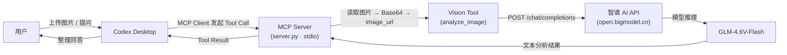

# GLM-Vision MCP Server

把智谱开放平台的免费视觉模型 **GLM-4.6V-Flash**（模型 ID：`glm-4.6v-flash`）封装成 MCP Server（`stdio`），让 Codex Desktop 等 MCP 客户端通过 `analyze_image` 工具获得识图、OCR、图表解析、截图分析、缺陷检测等能力。

> 本项目已在 Windows + Codex Desktop + DeepSeek（第三方模型）环境下真实跑通：用户上传图片后，Codex 自动调用 `mcp__glm_vision__analyze_image`，由 GLM-4.6V-Flash 返回分析结果。

---

## 1. 项目简介

**这是什么：** 一个用 Python 编写的 MCP（Model Context Protocol）Server，把智谱 AI 的视觉模型 `glm-4.6v-flash` 包装成一个标准的 MCP 工具 `analyze_image`。

**解决什么问题：** 很多主模型（如 DeepSeek）是纯文本模型，看不到图片。通过 MCP，Codex Desktop 这类客户端可以在“需要看图”时把图片交给视觉模型分析，再把文本结果带回给主模型继续处理。

**为什么需要 MCP：** MCP 是客户端（Codex Desktop）与外部工具之间的标准协议。你不需要为每个客户端写插件，只要实现一个 MCP Server，任何支持 MCP 的客户端都能用。

**最终实现：**

```text
Codex Desktop
  → MCP（stdio）
  → GLM Vision MCP Server
  → 智谱 AI API（glm-4.6v-flash）
  → 图片理解结果
```

---

## 2. 整体架构



---

## 3. 环境要求

| 环境 | 版本要求 | 作用 |
| --- | --- | --- |
| Windows | Windows 10/11 | 本项目所有命令均以 PowerShell 编写 |
| Python | 3.12（>=3.10 亦可） | 运行 MCP Server（server.py） |
| Node.js | 24 | Codex Desktop 自带运行时依赖；本项目本身不直接用 Node.js |
| Git | 任意较新版本 | 版本管理、上传 GitHub |
| Codex Desktop | 最新版 | MCP 客户端，负责拉起 Server 并调用工具 |
| 智谱 AI API Key | 免费即可 | 调用 GLM-4.6V-Flash 的凭证 |

> 说明：Node.js 24 是 Codex Desktop 应用内部运行环境的一部分（例如内置 `node` 运行时），本项目是纯 Python 实现，不直接调用 Node.js；仅当你要用 `npx` 启动其他 MCP Server，或某些客户端依赖 Node.js 时才需要单独安装。

---

## 4. 项目目录结构

```text
glm-vision-mcp/
├── server.py          # MCP Server 主体：工具定义、Base64 转换、智谱 API 调用
├── client_test.py     # stdio 联调脚本：不经过 Codex 直接测试 MCP 工具
├── requirements.txt   # Python 依赖
├── pyproject.toml     # 可选打包元数据（pip/uv 安装）
├── .env.example       # 环境变量模板（复制为 .env 后填写）
├── .env               # 实际 Key（本地生成，绝不提交）
├── .gitignore         # 排除 .env / .venv / __pycache__ 等
└── sample.png         # 示例测试图片
```

---

## 5. 创建项目

打开 PowerShell，执行：

```powershell
mkdir glm-vision-mcp
cd glm-vision-mcp
```

然后把本项目的 `server.py`、`client_test.py`、`requirements.txt`、`.env.example`、`.gitignore`、`sample.png` 放进来（或直接 `git clone` 本项目）。

> Git Bash 用户：`mkdir`/`cd` 命令完全一样；区别只是路径分隔符和换行。PowerShell 激活虚拟环境用 `.venv\Scripts\Activate.ps1`，Git Bash 用 `source .venv/Scripts/activate`。

---

## 6. 创建 Python 虚拟环境

在项目根目录执行：

```powershell
py -3.12 -m venv .venv
```

激活（PowerShell）：

```powershell
.\.venv\Scripts\Activate.ps1
```

**为什么需要 .venv：** 虚拟环境把 Python 依赖隔离在项目目录内，避免污染全局 Python，也避免不同项目依赖版本互相冲突。激活后 `python`/`pip` 都指向 `.venv` 内的解释器。后续所有命令都建议使用 `.\.venv\Scripts\python.exe` 显式调用，不依赖激活状态（Codex Desktop 配置里就是这么用的）。

---

## 7. 安装依赖

`requirements.txt` 内容（真实文件）：

```text
mcp>=2.0.0
httpx>=0.27
pydantic>=2.0
```

安装：

```powershell
.\.venv\Scripts\python.exe -m pip install -r requirements.txt
```

看到 `Successfully installed mcp-2.x httpx-... pydantic-...` 即成功。

---

## 8. 配置 .env

先复制模板：

```powershell
Copy-Item .env.example .env
```

编辑 `.env`，填入你的 Key：

```ini
# 智谱开放平台 API Key（必填）
# 获取：https://open.bigmodel.cn/ → API Keys → 创建
ZHIPU_API_KEY=你的_API_Key
```

**`.env` 是什么：** 存放本机密钥的本地文件，与代码分离。代码通过 `os.environ` 读取 `ZHIPU_API_KEY`，永不硬编码。

**为什么不能上传 GitHub：** `.env` 包含你的密钥，一旦公开任何人都能调用你的额度并产生费用。`.gitignore` 已排除 `.env`，上传前请再检查 `git status`。

**`.env` 查找逻辑：** `server.py` 会先从“当前工作目录”开始向上查找 `.env`（最多 5 层），找不到再退回 `server.py` 所在目录向上查找；找到即加载，`override=True`。所以即使你在 Jupyter/Notebook 里只运行某一个单元，只要工作目录在项目内，也能读到配置。

可选变量（均有默认值）：

```ini
# GLM_VISION_MODEL=glm-4.6v-flash
# GLM_VISION_API_URL=https://open.bigmodel.cn/api/paas/v4/chat/completions
# GLM_VISION_MAX_TOKENS=1024
# GLM_VISION_TIMEOUT=120
```

---

## 9. .gitignore

真实内容：

```gitignore
.venv/
__pycache__/
*.pyc
.env
```

这保证 `.env`、虚拟环境和 Python 缓存不会被 `git add .` 误提交。

---

## 10. 智谱 API 测试

不经过 MCP，直接验证 API Key 是否有效：

```powershell
.\.venv\Scripts\python.exe server.py --test-image sample.png "请描述这张图片"
```

成功时应看到一段图片描述文字（例如“这是一张生日贺卡……”），且命令退出码为 0。

如果返回 **401**：

- 检查 `.env` 里 `ZHIPU_API_KEY` 是否填了真实 Key（形如 `xxxxxxxx.xxxxxxxx`），不是占位符；
- 检查 Key 是否带多余空格/引号；
- 到智谱开放平台确认该 Key 存在且未删除；
- 确认模型名 `glm-4.6v-flash` 与 Endpoint `https://open.bigmodel.cn/api/paas/v4/chat/completions` 未被改。

> 重点：401 不一定是代码格式错误，绝大多数情况是 **API Key 身份认证失败**（Key 无效/过期/填错）。代码层面会原样透出智谱返回的错误 JSON，先读错误信息里的 `message`。

---

## 11. Vision Tool

工具名：`analyze_image`

描述：分析一张或多张图片（支持本地路径、http(s) URL、data URI），返回模型文本结果，可用于 OCR、图表解析、内容理解、缺陷检测等。

| 参数 | 类型 | 默认值 | 说明 |
| --- | --- | --- | --- |
| `image_path` | string | 无 | 单张图片：本地路径 / URL / data URI（与 `images` 二选一） |
| `images` | string[] | 无 | 多张图片列表（与 `image_path` 二选一；同时传入时 `image_path` 会追加到列表末尾） |
| `prompt` | string | 请详细描述这张图片的内容。 | 分析指令 |
| `thinking` | boolean | false | 思考模式（更慢但更细致） |
| `max_tokens` | integer | 1024 | 最大输出 token 数（1–8192） |
| `include_reasoning` | boolean | false | 思考模式下是否一并返回思考过程 |

输出：纯文本分析结果（返回给 Codex/主模型）。

**Codex 为什么能知道这个 Tool：** MCP Server 启动时通过 stdio 完成初始化握手，向客户端（Codex 的 MCP Client）发送 `tools/list`，声明 `analyze_image` 及其参数 JSON Schema。Codex 把可用工具注入当前会话的工具列表（形如 `mcp__glm_vision__analyze_image`），模型看到描述后即可发起调用。

---

## 12. MCP Server

`server.py` 承担四件事：

1. **接收 Tool Call：** 以 stdio 运行，按 MCP 协议从 stdin 读 JSON-RPC 请求（`tools/call`），分发给 `analyze_image`。
2. **读取图片：** 本地路径 → 读取字节 → 按 MIME 类型（png/jpg/jpeg/webp）转 `data:image/xxx;base64,...`；http(s) URL / data URI 原样透传。
3. **调用 GLM-4.6V-Flash：** 组装 OpenAI 兼容请求（`image_url` 格式 + `text` 指令），`POST` 到 `https://open.bigmodel.cn/api/paas/v4/chat/completions`，携带 `Authorization: Bearer <ZHIPU_API_KEY>`；对 429 限流与临时网络错误做指数退避重试（2s/4s/8s）。
4. **返回结果：** 解析 `choices[0].message.content`，通过 MCP 把文本结果从 stdout 写回客户端。

---

## 13. stdio MCP

**stdio 是什么：** 标准输入/输出（Standard Input/Output）传输。MCP Client 以子进程方式启动 Server，通过进程的 stdin/stdout 交换 JSON-RPC 消息——不需要网络端口，进程生则通道通，进程死则通道断。

**为什么这里用 stdio：** 本项目是本地 Python 进程，没有远程服务需求；stdio 配置最简单、最安全（Key 不出本机），也是 Codex Desktop 默认支持的本地 MCP 方式。

**Codex Desktop 如何通信：** Codex 按配置的 `command` + `args` 拉起 `python server.py`，然后：

```text
Codex ──(写)→ stdin → MCP Server
Codex ←─(读)── stdout ← MCP Server
```

**⚠️ 重要：stdout 是协议通道，不要输出普通日志！** 所有日志必须走 stderr。本项目已遵守：httpx 日志级别被调低，`logging` 默认写 stderr。如果你改代码，也请用 `logger.warning(..., file=sys.stderr)` 或 `logging` 输出到 stderr，否则会破坏协议导致客户端无法解析。

---

## 14. Codex Desktop 配置

Codex Desktop 与 Codex CLI/IDE 共享全局配置 `~/.codex/config.toml`（Windows 为 `C:\Users\<你的用户名>\.codex\config.toml`）。MCP 用 `[mcp_servers.<名字>]` 表声明，本项目实际使用的配置如下：

```toml
[mcp_servers."glm-vision"]
command = "C:\\Users\\<你的用户名>\\path\\to\\glm-vision-mcp\\.venv\\Scripts\\python.exe"
args = ["C:\\Users\\<你的用户名>\\path\\to\\glm-vision-mcp\\server.py"]
cwd = "C:\\Users\\<你的用户名>\\path\\to\\glm-vision-mcp"
startup_timeout_sec = 30
tool_timeout_sec = 120
default_tools_approval_mode = "auto"

[mcp_servers."glm-vision".env]
ZHIPU_API_KEY = "你的_API_Key"
```

字段含义：

| 字段 | 值 | 作用 |
| --- | --- | --- |
| `command` | venv 里的 python.exe 绝对路径 | 用哪个解释器启动 Server |
| `args` | server.py 绝对路径 | 传给解释器的启动参数 |
| `cwd` | 项目目录 | Server 的工作目录（影响相对路径与 `.env` 查找起点） |
| `env` | `ZHIPU_API_KEY` | 以环境变量方式注入 Key（也可省略，由 `.env` 兜底） |
| `startup_timeout_sec` / `tool_timeout_sec` | 30 / 120 | 启动与单次调用超时 |
| `default_tools_approval_mode` | `auto` | 工具调用自动放行 |

配置步骤：

1. 用记事本打开 `C:\Users\<你的用户名>\.codex\config.toml`；
2. 粘贴上面的配置，并把路径与 Key 替换成你的；
3. 保存后**完全退出 Codex Desktop**（不是关窗口，是退出应用），再重新打开；
4. 在 MCP 状态页应看到 `glm-vision 已启用`；在输入框输入 `/mcp` 也可查看已连接服务器；
5. 新建对话，工具列表应出现 `mcp__glm_vision__analyze_image`。

> 注意：不同客户端配置位置不同（Claude Desktop 用 `claude_desktop_config.json`，Cursor 用 `.cursor/mcp.json`），字段结构一致，只是顶层键不同。

---

## 15. 启动 MCP Server

**手动启动（联调用）：**

```powershell
.\.venv\Scripts\python.exe server.py
```

程序会以 stdio 模式运行，等待客户端连接；**不要在普通终端里期待看到输出**（协议走 stdout，日志走 stderr）。想验证协议可用，用 `client_test.py`：

```powershell
.\.venv\Scripts\python.exe client_test.py sample.png "请识别图中的文字"
```

**Codex Desktop 自动启动：** 你不需要手动运行任何命令。Codex 启动会话时按 config.toml 的 `command`/`args` 自动拉起子进程，退出 Codex 时自动结束。手动启动只用于调试。

---

## 16. Codex 调用视觉模型

在 Codex Desktop 新建对话，上传图片后直接输入（任选）：

```text
请使用视觉 MCP 工具分析这张图片。
```

```text
请识别图片中的文字。
```

```text
请描述图片中的主要内容。
```

```text
请分析这张截图中的错误。
```

Codex 会判断需要视觉能力，自动调用 `analyze_image(image_path=图片临时路径, prompt=你的指令)`。

---

## 17. 完整调用链

```text
用户
  ↓ 上传图片 + 提问
Codex Desktop
  ↓ 判断需要视觉能力
MCP Client
  ↓ stdio (JSON-RPC)
MCP Server (server.py)
  ↓ 分发 tools/call
Vision Tool (analyze_image)
  ↓ 读取图片文件
Base64 → image_url
  ↓ POST chat/completions
智谱 AI API
  ↓ 模型推理
GLM-4.6V-Flash
  ↓ 视觉分析文本
智谱 AI API
  ↓ choices[0].message.content
MCP Server
  ↓ Tool Result (stdout)
Codex Desktop
  ↓ 组织回答
用户
```

---

## 18. 常见问题

### 问题 1：401

身份认证失败。依次检查：

1. `.env` 里 `ZHIPU_API_KEY` 是否为真实 Key（不是占位符）；
2. Key 是否有多余空格、引号、换行；
3. 智谱开放平台该 Key 是否有效、未删除；
4. 模型名是否为 `glm-4.6v-flash`、Endpoint 是否为 `https://open.bigmodel.cn/api/paas/v4/chat/completions`。

### 问题 2：找不到 .env

`server.py` 会从当前工作目录向上查找（最多 5 层），再退回 `server.py` 所在目录向上查找。若仍未找到：确认 `.env` 确实在项目内、文件名不是 `.env.txt`；或直接用环境变量：

```powershell
$env:ZHIPU_API_KEY="你的_API_Key"
```

### 问题 3：MCP Server 启动失败

手动执行 `.\ .venv\Scripts\python.exe server.py` 看 stderr 报错：

- Python 不存在 → 重新 `py -3.12 -m venv .venv`；
- 依赖缺失 → 重新 `pip install -r requirements.txt`；
- 路径错误 → 检查 config.toml 里 `command`/`args`/`cwd` 是否为绝对路径且存在；
- 启动即退出 → 检查 `.env` 是否可读、Key 是否为空。

### 问题 4：Codex 找不到 MCP Tool

- 确认 config.toml 语法正确、保存后**完全重启** Codex Desktop；
- MCP 状态页是否显示 `glm-vision 已启用`；
- 用 `client_test.py` 验证 Server 本身能注册工具；
- 若 Server 正常但 Codex 会话里仍看不到工具：检查主模型是否为第三方模型且 `models.json` 中该模型 `supports_search_tool` 为 `true`。新版 Codex 会把 MCP 工具放到 tool_search 延迟发现路径，第三方模型若未实现该路径工具将永不出现。**本项目实测解法：把对应模型的 `supports_search_tool` 改为 `false` 后完全重启 Codex，MCP 工具即直接注入工具列表。**（官方 OpenAI 模型一般无此问题。）

### 问题 5：图片无法识别

- 本地路径是否存在、文件名是否含中文（建议用绝对路径）；
- 是否支持格式：png/jpg/jpeg/webp（已内置 webp MIME 映射）；
- 图片是否超过接口大小限制（建议 < 8MB）；
- URL 是否公开可访问；data URI 是否完整。

### 问题 6：API 可以调用，但是 Codex 无法调用

逐层排查，不要跳层：

1. **API 层：** `server.py --test-image sample.png` 能否返回文本？（Key/模型/Endpoint 问题）
2. **MCP 层：** `client_test.py sample.png` 能否列出工具并调用成功？（Server/stdio/依赖问题）
3. **Codex 层：** 配置、重启、工具列表、`supports_search_tool` 问题。

哪一层先失败就修哪一层。

---

## 19. 三层测试方法

**第一层：直连智谱 API（验证 Key 与模型）**

```powershell
.\.venv\Scripts\python.exe server.py --test-image sample.png "请描述这张图片"
```

**第二层：直接测 MCP Server（验证 stdio 与工具）**

```powershell
.\.venv\Scripts\python.exe client_test.py sample.png "请识别图中的文字"
```

期望输出：`已注册工具： analyze_image`，随后是识别结果。

**第三层：通过 Codex Desktop 测试**

重启 Codex → 新对话 → 上传图片 → 输入“请分析这张图片”。

> 原则：不要一开始就测 Codex。前两层通过后，第三层问题只会在配置/注入层面。

---

## 20. GitHub 上传

在项目根目录执行（PowerShell）：

```powershell
git init
git add .
git status
```

`git status` 中**绝不能出现 `.env` 或 `.venv/`**。确认后：

```powershell
git commit -m "feat: GLM-4.6V-Flash vision MCP server"
git branch -M main
git remote add origin https://github.com/<你的用户名>/glm-vision-mcp.git
git push -u origin main
```

如果曾误提交过密钥：`git rm --cached .env` 后提交，并**立即去智谱平台重置 Key**（历史记录里仍有泄露）。

---

## 21. 安全说明

绝对不要：

- 把 API Key 写死在代码里；
- 把 `.env` 上传 GitHub；
- 把 Key 写进 README；
- 把 Key 放进截图；
- 把含 Key 的日志贴到公开渠道。

如果 Key 泄露：立即到智谱开放平台删除/重置该 Key，再重新生成并更新 `.env`。

---

## 验收清单

- [ ] `py -3.12 -m venv .venv` 成功
- [ ] `pip install -r requirements.txt` 成功
- [ ] `.env` 已创建且包含真实 `ZHIPU_API_KEY`
- [ ] 第一层：`server.py --test-image sample.png` 返回描述
- [ ] 第二层：`client_test.py sample.png` 列出并调用 `analyze_image`
- [ ] Codex Desktop config.toml 已配置 `[mcp_servers."glm-vision"]`
- [ ] 完全重启后 MCP 状态页显示 `glm-vision 已启用`
- [ ] 上传图片后 Codex 自动调用 `mcp__glm_vision__analyze_image`
- [ ] `git status` 无 `.env` / `.venv`
